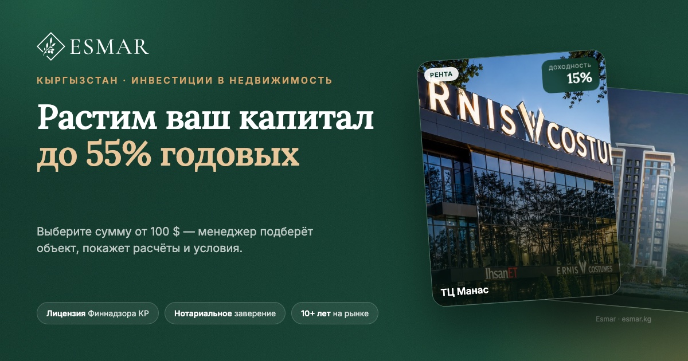

# Esmar — landing gateway (RU / KY)

Прокладка для трафика из Meta Ads в WhatsApp: собирает клик-идентификаторы и всю
атрибуцию, передаёт лид в CRM, а события воронки — обратно в Meta через
Conversions API. Двуязычная (русский / кыргызский), с автоопределением языка.



---

## 1. Что внутри

| Блок | Реализация |
| --- | --- |
| Лендинг | Next.js 16 (App Router, RSC), TypeScript, Tailwind CSS v4 |
| 3D-«барабан» объектов | [Swiper 11](https://github.com/nolimits4web/swiper) `effect="coverflow"` + `autoplay.reverseDirection` (движение слева → направо), кастомные точки, пауза, свайп, keyboard, A11y |
| UI-компоненты | [shadcn/ui](https://github.com/shadcn-ui/ui) паттерны (Button, Accordion, cva-варианты), [Radix UI](https://github.com/radix-ui/primitives) (Accordion, RadioGroup-паттерн, Slot), [lucide-react](https://github.com/lucide-icons/lucide) |
| Liquid glass | стеклянные слои на `backdrop-filter` + спекулярный блик (подход [glasscn-ui](https://github.com/itsjavi/glasscn-ui)), собственные токены в `globals.css` |
| Анимации | CSS-переходы + `drum-progress`, `nudge`, sheen; `prefers-reduced-motion` учтён |
| Шрифты | self-hosted Inter + Lora (кириллица + киргизские ө/ү/ң) — без запросов к Google Fonts в рантайме |
| Трекинг | Meta Pixel (браузер) + CAPI (сервер) с общим `event_id` (дедупликация) |
| CRM | исходящий webhook `lead.created` c HMAC-подписью + входящий `/api/crm/lead` (стадии → события Meta) |
| Хранилище | Postgres (автосхема) или in-memory фолбэк для локальной разработки |

Брендинг взят с [esmar.kg](https://esmar.kg): логотип (бронза `#BB7A36`, ромб с оливковой
ветвью), палитра (тёмно-зелёный + беж), объекты, площади, адреса, сроки сдачи, продукты,
лицензия, контакты и юридические тексты.

---

## 2. Быстрый старт

```bash
npm install
cp .env.example .env.local     # заполнить минимум PUBLIC_BASE_URL
npm run dev                    # http://localhost:3000
```

Без переменных окружения лендинг работает, лид сохраняется в память процесса,
события помечаются `skipped` (Meta не настроена) — удобно для дизайн-итераций.

```bash
npm run build && npm start     # production-сборка
npm test                       # 14 unit-тестов трекинга/подписи
```

### Язык

`/` → 307 на `/ru` или `/ky`:

1. `?lang=ky|ru` (явное переопределение, параметр вырезается из URL)
2. cookie `esm_locale` (ставится при переключении)
3. `Accept-Language` (`ky*` → ky, `ru/kk/uz/be` → ru)
4. гео `x-vercel-ip-country` / `cf-ipcountry` = `KG` → ky
5. иначе `ru`

Переключатель в шапке меняет URL и cookie. `hreflang`, canonical, sitemap — на месте.

---

## 3. Переменные окружения

Смотрите [`.env.example`](.env.example). Ключевые:

| Переменная | Зачем |
| --- | --- |
| `NEXT_PUBLIC_META_PIXEL_ID` | пиксель в браузере |
| `META_PIXEL_ID`, `META_CAPI_TOKEN` | серверный Conversions API |
| `META_TEST_EVENT_CODE` | прогон в Events Manager → Test events |
| `NEXT_PUBLIC_WHATSAPP_NUMBER` | номер для wa.me (по умолчанию `996222111114`) |
| `CRM_WEBHOOK_URL`, `CRM_WEBHOOK_SECRET` | куда и чем подписывать лиды |
| `CRM_INBOUND_SECRET` | проверка входящих стадий из CRM |
| `DATABASE_URL` | Postgres для лидов и outbox (**обязательно в проде**) |
| `ADMIN_TOKEN` | доступ к `/admin?token=…` |
| `CRON_SECRET` | защита `/api/cron/dispatch` |
| `PUBLIC_BASE_URL` | canonical, OG, ссылки в CRM |
| `SEND_LEAD_ON_SUBMIT` | `true` — слать `Lead` с лендинга, если CRM ещё не умеет обратный вызов |

> **Важно:** без `DATABASE_URL` на serverless атрибуция живёт только в памяти инстанса
> и теряется между cold start. Для боевого трафика Postgres обязателен.

---

## 4. Воронка = событие

Стадия в CRM приходит на `/api/crm/lead`, маппится в событие Meta:

| Стадия CRM (`stage`) | Событие Meta | Комментарий |
| --- | --- | --- |
| `card_created`, `basic_lead`, `new_lead`, `lead` | **Lead** | карточка появилась в CRM = базовый лид |
| `qualified`, `qualification` | `QualifiedLead` | квалифицирован менеджером |
| `meeting_booked`, `meeting` | `Schedule` | назначена встреча |
| `meeting_held`, `office_visit` | `MeetingHeld` | визит/встреча проведена |
| `contract_sent`, `contract_signed` | `SubmitApplication` | договор |
| `deal_won`, `paid` | **Purchase** (с `value`) | сделка |
| `lost`, `disqualified` | `LeadDisqualified` | отказ |

Любое валидное имя события можно передать явно: `"event_name": "MyEvent"`.

Что шлёт сам лендинг:

| Действие | Браузер | CAPI |
| --- | --- | --- |
| загрузка | `PageView` | `PageView` (тот же `event_id`) |
| показ слайдера | `ViewContent` | `ViewContent` |
| выбор суммы | `SelectAmount` (custom) | — |
| клик «Продолжить» | `Contact` | `Contact` (тот же `event_id`) |

`Lead` намеренно **не** отправляется с лендинга — источник истины это карточка в CRM,
иначе получите двойной счёт. Флаг `SEND_LEAD_ON_SUBMIT=true` — только как временный
фолбэк, пока интеграция с CRM не готова.

---

## 5. Что собираем (атрибуция)

Клик-идентификаторы: `fbclid`, `fbc`, `fbp`, `ctwa_clid`, `gclid`, `gbraid`, `wbraid`,
`ttclid`, `yclid`, `msclkid`, `twclid`.

Контекст: `utm_source/medium/campaign/content/term/id/source_platform/creative_format`,
`referrer`, `landing_url` (first touch), `current_url` (last touch), `_ga` client_id и
`_ga_*` session_id, `locale`, `browser_lang`, `timezone`, `screen`, `device`,
`visitor_id`, `first_seen_at`, `last_seen_at`, `click_ts`.

Сервер добавляет: `ip`, `ua`, `country`, `city` (Vercel/Cloudflare заголовки).

Правила:

- **first touch** (utm, fbclid, landing, referrer) фиксируется навсегда;
- **last touch** обновляет `fbp`, `fbc`, `current_url`, таймстемпы;
- `fbc` восстанавливается из `fbclid` как `fb.1.<click_ts_ms>.<fbclid>`;
- хранение: first-party cookie `esm_attr` (90 дней) + `localStorage`, плюс копия в БД;
- всё санитизируется на сервере: whitelist ключей, обрезка длины, удаление control-char.

---

## 6. API

| Метод | Путь | Назначение |
| --- | --- | --- |
| `POST` | `/api/lead` | создать лид, отдать `lead_id`, `event_id`, `whatsapp_url` |
| `POST` | `/api/track` | браузерные события в CAPI (`PageView`, `ViewContent`, `SelectAmount`, `Contact`, `InitiateCheckout`) |
| `POST` | `/api/crm/lead` | стадия из CRM → событие Meta (HMAC) |
| `GET/POST` | `/api/cron/dispatch` | ретраи CAPI и CRM (Vercel Cron, `Bearer $CRON_SECRET`) |
| `GET` | `/api/health` | статус интеграций |
| `GET` | `/admin?token=…` | лиды, outbox, ошибки |

Пример:

```bash
curl -s -X POST https://land.esmar.kg/api/lead \
  -H 'content-type: application/json' \
  -d '{"amount_tier":"s2","locale":"ky","attribution":{"fbclid":"…","fbp":"fb.1.…","utm":{"source":"facebook"},"landing_url":"https://land.esmar.kg/ky?fbclid=…","visitor_id":"…"}}'
```

```json
{
  "ok": true,
  "lead_id": "ESM-XQMGMZ",
  "event_id": "ESM-XQMGMZ-contact",
  "whatsapp_url": "https://wa.me/996222111114?text=…(Билдирме: ESM-XQMGMZ)",
  "amount": { "tier": "s2", "value": 2750, "label": "500 – 5 000 $" }
}
```

`lead_id` попадает в предзаполненное сообщение WhatsApp — по нему CRM связывает чат
с карточкой, а мы находим атрибуцию при обратном вызове.

---

## 7. CRM-интеграция

Полный контракт: [`docs/CRM-INTEGRATION.md`](docs/CRM-INTEGRATION.md).

Коротко:

1. CRM принимает `POST lead.created` с заголовком
   `x-esmar-signature: t=<unix>,v1=<hmac_sha256(secret, "<t>.<raw body>")>`.
2. CRM создаёт карточку и сразу зовёт `POST /api/crm/lead` с
   `{"lead_id":"ESM-…","stage":"card_created"}` и той же схемой подписи
   (`CRM_INBOUND_SECRET`).
3. Мы достаём из БД `fbc/fbp/ip/ua`, шлём `Lead` в CAPI с `event_id`, который CRM
   может использовать для сверки.

Идемпотентность: `crm_event_id` (или `lead_id + stage + occurred_at`) — повторный
запрос не создаёт второе событие.

---

## 8. Деплой (Vercel)

1. Import repo → framework Next.js (определится сам).
2. Env: `DATABASE_URL` (Neon/Supabase), Meta, CRM, `PUBLIC_BASE_URL=https://land.esmar.kg`,
   `CRON_SECRET`, `ADMIN_TOKEN`.
3. `vercel.json` уже содержит cron `*/5 * * * *` на `/api/cron/dispatch`
   (Vercel сам подставит `Authorization: Bearer $CRON_SECRET`).
4. Привязать домен, проверить `https://land.esmar.kg/api/health`.
5. В Meta: домен верифицировать, пиксель → CAPI токен, проверить Test events,
   затем отключить `META_TEST_EVENT_CODE`.

Docker/Node-хостинг: `npm ci && npm run build && npm start`, cron дергать
`curl -H "Authorization: Bearer $CRON_SECRET" https://…/api/cron/dispatch`.

---

## 9. QA-чеклист перед запуском

- [ ] `/` редиректит по языку браузера; переключатель меняет язык и cookie.
- [ ] Кириллица и ө/ү/ң отображаются в Lora/Inter (без подмены шрифта).
- [ ] Слайдер листается раз в 2 сек справа налево по смыслу (карточка уходит вправо),
      точки кликабельны, пауза работает, свайп на телефоне.
- [ ] «Продолжить» без выбора подсвечивает варианты; с выбором открывает WhatsApp
      с текстом, суммой и `lead_id`.
- [ ] В `wa.me` правильный номер и язык сообщения.
- [ ] `/api/health` — все интеграции `true`.
- [ ] В Test events видны `PageView`, `ViewContent`, `Contact`, `Lead`.
- [ ] CRM получает подписанный `lead.created` с `fbc/fbp/utm`.
- [ ] `/api/crm/lead` со стадией `card_created` → `Lead`, `deal_won` → `Purchase`.
- [ ] Повторная отправка стадии не дублирует событие.
- [ ] Мобильный Lighthouse: LCP < 2.5 s (изображения 640/1200, lazy для не-первых).
- [ ] Нет горизонтального скролла на 320/360/390/430 px.
- [ ] `prefers-reduced-motion` отключает автопрокрутку-анимации.

---

## 10. Структура

```
src/
  app/
    [locale]/          лендинг (RU/KY), метаданные, JSON-LD
    api/lead|track|crm|cron|health
    admin/             ops-панель
  components/          glass-UI, барабан, пикер суммы, sticky CTA
  data/                объекты и бренд-константы
  i18n/                словари ru/ky + типы
  lib/
    analytics/client   сбор атрибуции, пиксель, отправка
    meta/              CAPI + маппинг стадий
    store/             memory / postgres
  proxy.ts             определение языка
tests/                 vitest
scripts/               скриншоты, подпись payload, mock CRM/Meta
```

---

## 11. Ограничения и следующие шаги

- Лендинг не заменяет CRM: дедупликация лидов по телефону — на стороне CRM.
- `SelectAmount` уходит только из браузера (не в CAPI) — чтобы не зашумлять обучение.
- Если трафик пойдёт из Click-to-WhatsApp (без сайта), нужен `ctwa_clid` из referral
  payload WhatsApp Business API — поле уже поддержано в схеме.
- Для сквозной аналитики по менеджерам добавьте в CRM стадию с `manager` — она уедет
  в `custom_data`.
